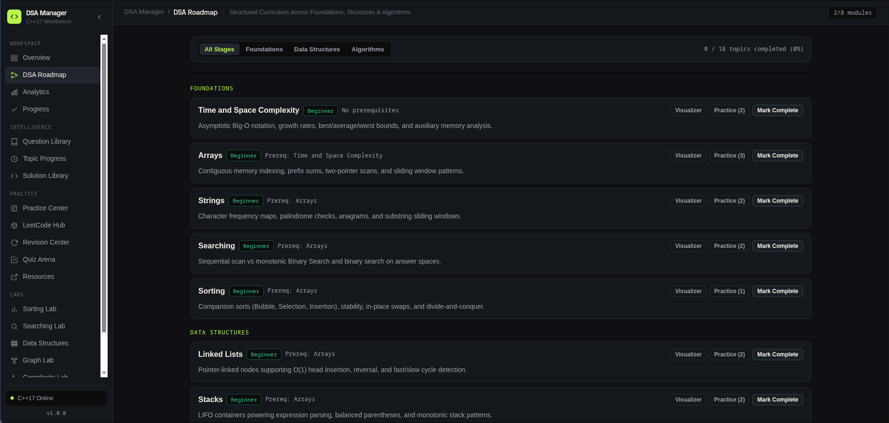
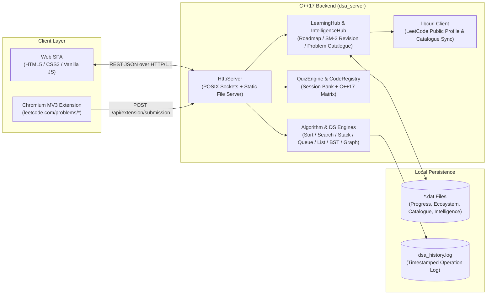

<div align="center">

# DSA Manager Lite (`Dsa-Learner`)

**A C++17 Data Structures & Algorithms Visualization Workbench, Learning Intelligence Hub, and Spaced-Repetition Practice Suite.**


<br />



</div>

---

## Table of Contents

- [Overview](#overview)
- [System Architecture](#system-architecture)
- [Core Modules](#core-modules)
- [C++17 Engine & Design Highlights](#c17-engine--design-highlights)
- [Project Structure](#project-structure)
- [Quick Start](#quick-start)
- [CLI Configuration](#cli-configuration)
- [Optional Chromium Extension (MV3)](#optional-chromium-extension-mv3)
- [HTTP API Reference](#http-api-reference)
- [Local Persistence](#local-persistence)

---

## Overview

**DSA Manager Lite** pairs a native **C++17 multi-threaded POSIX HTTP/1.1 server** with a **zero-dependency dark-mode Single-Page Application** (`web/`). Every algorithm trace, data-structure mutation, microsecond benchmark, spaced-repetition calculation, and LeetCode catalogue query is executed by the C++17 backend and persisted locally in flat data files—no Node.js build chain or external database required.

---

## System Architecture



---

## Core Modules

### 1. Workspace & Curriculum
| Module | What It Does |
| :--- | :--- |
| **Overview** | Displays learning completion summary, continue-learning shortcut, persisted study goal, recent solved problems, and upcoming revisions. |
| **DSA Roadmap** | 18 structured topics organized across **Foundations**, **Data Structures**, and **Algorithms** with prerequisites, difficulty tags, visualizer deep-links, and completion toggles. |
| **Analytics** | Tracks real solved counts, Easy/Medium/Hard distribution, daily streak, 28-day activity heatmap, 7-day trend, and weakest vs. most-practiced topics. |
| **Progress** | Per-module completion tracking (`sorting`, `searching`, `datastructures`, `comparator`, `bst`, etc.) persisted to disk. |

### 2. Intelligence Hub
| Module | What It Does |
| :--- | :--- |
| **Question Library** | Syncs the LeetCode problem catalogue via `libcurl` (or manual JSON import) with server-side pagination, multi-filter search (difficulty, topic, free/premium, status), and sorting. |
| **Problem Detail & Notes** | 9-section structured Markdown notes (*Intuition, Brute Force, Optimized, Time/Space Complexity, Mistakes Made, Observations, C++ Snippet, Revision Comments*) plus full-text notes search. |
| **Topic Progress** | Automatic tag-level completion & difficulty breakdowns with customizable per-topic target goals. |
| **Solution Library** | Store, search, and compare multiple C++ approaches per problem with complexity metadata. |

### 3. Practice, Revision & LeetCode Sync
| Module | What It Does |
| :--- | :--- |
| **Practice Center** | Built-in curated practice problems with hints, approach editor, attempts counter, bookmarking, and revision flags. |
| **LeetCode Hub** | Public profile stats sync (`libcurl`), recent accepted submission detection, manual submission JSON import, and live extension heartbeat status. |
| **Revision Center** | Spaced-repetition scheduling (`Again`, `Difficult`, `Good`, `Easy`) for both problems and flashcards, plus a dedicated mistake log. |
| **Quiz Arena** | Randomized timed-session DSA quizzes with category filtering, instant answer grading, and accuracy history. |
| **Resources** | Curated external DSA & competitive-programming reference links. |

### 4. Interactive Algorithm & Data Structure Labs
| Lab | C++17 Implementation Highlights |
| :--- | :--- |
| **Sorting Lab** | Step-by-step animated traces for **Bubble Sort**, **Selection Sort**, and **Insertion Sort** with comparison/swap counters and pattern array generators. |
| **Searching Lab** | **Linear Search** and **Binary Search** (`L` / `M` / `H` pointer trace, unsorted validation + auto-sort option). |
| **Data Structures** | **BoundedStack** (`std::stack<int>`), **BoundedQueue** (`std::queue<int>`), **BoundedLinkedList** (`std::unique_ptr<Node>`), and **BinarySearchTree** (insert, search, 3-case delete, inorder/preorder/postorder traversals). |
| **Graph Lab** | Adjacency-list directed/undirected `Graph` (`std::map<std::string, std::vector<std::string>>`) with animated **BFS** and **DFS** traversals. |
| **Complexity Lab** | Live microsecond benchmarks (`std::chrono::steady_clock`) comparing empirical runtimes against theoretical Big-O bounds. |
| **Code Library** | Reference C++17 implementations, pseudocode, and a side-by-side Complexity Matrix. |

---

## C++17 Engine & Design Highlights

- **Polymorphic Algorithm Hierarchy:** `Algorithm` abstract base class extended by `Sorter` (`BubbleSorter`, `SelectionSorter`, `InsertionSorter`) and `Searcher` (`LinearSearcher`, `BinarySearcher`), instantiated via factory helpers (`createSorter`, `createSearcher`).
- **RAII & Smart Pointers:** Linked list and BST nodes (`std::unique_ptr<Node>`) guarantee leak-free ownership without manual `delete`.
- **Generic Templates & Operator Overloading:** Header utilities (`utils::swapValues`, `utils::isSorted`, `utils::joinValues`), `Metrics` accumulation (`operator+`, `operator==`, `operator<<`), and `operator+=` on `BoundedStack` / `BoundedQueue`.
- **Custom Exception Hierarchy & Thread Safety:** Domain exceptions (`ValidationException`, `OverflowException`, etc.) and `std::mutex` guards across shared server state.
- **Custom Lightweight JSON Layer:** Zero external JSON dependencies (`include/dsa/Json.hpp`, `src/Json.cpp`).

---

## Project Structure

```text
dsa-manager-lite/
├── CMakeLists.txt              # CMake build config (dsa_core, dsa_server, dsa_tests)
├── include/dsa/                # C++17 headers
│   ├── Algorithms.hpp          # Generic utils + Sorter/Searcher class hierarchy
│   ├── BinarySearchTree.hpp    # BST with step traces & traversal snapshots
│   ├── CodeRegistry.hpp        # Reference C++17 & pseudocode registry
│   ├── DataStructures.hpp      # BoundedStack, BoundedQueue, BoundedLinkedList
│   ├── Graph.hpp               # Adjacency-list Graph + BFS/DFS
│   ├── HistoryLogger.hpp       # Timestamped file operation logger
│   ├── HttpServer.hpp          # POSIX HTTP/1.1 server & API router
│   ├── IntelligenceHub.hpp     # Problem catalogue, notes, solutions, LeetCode sync
│   ├── Json.hpp                # Built-in JSON parser & serializer
│   ├── LearningHub.hpp         # Roadmap, practice, flashcards, analytics
│   ├── ProgressManager.hpp     # Module completion persistence
│   ├── QuizEngine.hpp          # Quiz session manager & question bank
│   └── Types.hpp               # Shared structs, metrics & domain exceptions
├── src/                        # C++17 implementations & main.cpp entrypoint
├── web/                        # Zero-dependency SPA frontend
│   ├── index.html
│   ├── app.js
│   └── styles.css
├── browser-extension/          # Optional Chromium Manifest V3 LeetCode helper
│   ├── manifest.json
│   ├── background.js
│   ├── content.js
│   ├── popup.html
│   └── popup.js
├── tests/
│   └── test_dsa.cpp            # CTest unit test suite
└── docs/
    └── screenshots/
        └── dsa-roadmap.png
```

---

## Quick Start

### Prerequisites
- **CMake** `>= 3.16`
- **C++17** compiler (`g++` / `clang++`)
- **libcurl** development library (e.g., `libcurl4-openssl-dev` on Debian/Ubuntu)
- POSIX environment (Linux / macOS)

### Build, Test & Run

```bash
# 1. Configure & compile
cmake -S . -B build
cmake --build build -j

# 2. Run the C++ unit test suite
ctest --test-dir build --output-on-failure

# 3. Start the HTTP server
./build/dsa_server --port 8080
```

Open **[http://127.0.0.1:8080](http://127.0.0.1:8080)** in your browser.

---

## CLI Configuration

`./build/dsa_server` supports custom paths and ports via command-line flags:

| Flag | Short | Default | Description |
| :--- | :---: | :--- | :--- |
| `--port` | `-p` | `8080` | TCP port to bind the HTTP server |
| `--web` | `-w` | `web` (auto-resolved) | Path to static frontend directory |
| `--log` | `-l` | `dsa_history.log` | Operation history log file |
| `--progress` | — | `dsa_progress.dat` | Module completion persistence file |
| `--ecosystem` | — | `dsa_ecosystem.dat` | Roadmap, flashcards, and practice state |
| `--catalogue` | — | `dsa_catalogue.dat` | Synced LeetCode problem catalogue cache |
| `--intel` | — | `dsa_intelligence.dat` | Notes, solutions, profile & spaced-repetition data |
| `--help` | `-h` | — | Print usage banner and exit |

---

## Optional Chromium Extension (MV3)

Automatically detect **Accepted** submissions on `https://leetcode.com/problems/*` and forward non-sensitive problem metadata to your local backend:

1. Open `chrome://extensions` in Chrome, Brave, or Edge.
2. Enable **Developer mode** (top-right toggle).
3. Click **Load unpacked** and select the [`browser-extension/`](browser-extension/) directory.
4. Keep `dsa_server` running on `http://127.0.0.1:8080` while solving problems on LeetCode.

---

## HTTP API Reference

The C++ server exposes a RESTful JSON API under `/api/*` alongside static file serving:

<details>
<summary><strong>Click to expand all 53 API endpoints</strong></summary>

| Group | Method | Endpoint | Purpose |
| :--- | :---: | :--- | :--- |
| **Overview & History** | `GET` | `/api/overview` | Workspace summary & server status |
| | `GET` | `/api/history` | Fetch operation history log |
| | `DELETE` | `/api/history` | Clear operation history log |
| | `GET` | `/api/code` | Fetch reference C++17 code & complexity matrix |
| **Sorting & Searching** | `POST` | `/api/array/generate` | Generate random or patterned arrays |
| | `POST` | `/api/sort` | Run Bubble / Selection / Insertion sort with step trace |
| | `POST` | `/api/search` | Run Linear / Binary search with step trace |
| | `POST` | `/api/compare` | Run `steady_clock` microsecond benchmark comparison |
| **Data Structures** | `GET` | `/api/ds/state` | Current Stack, Queue, and Linked List state |
| | `POST` | `/api/ds/stack` | Push, batch push, pop, peek, clear, resize |
| | `POST` | `/api/ds/queue` | Enqueue, batch enqueue, dequeue, front, clear, resize |
| | `POST` | `/api/ds/list` | Insert head/tail, remove, find, load sample, clear |
| | `GET` | `/api/bst/state` | Current BST node layout & metrics |
| | `POST` | `/api/bst/op` | Insert, search, delete, traverse, sample, clear |
| | `GET` | `/api/graph/state` | Current Graph vertices & edges |
| | `POST` | `/api/graph/op` | Add/remove vertex or edge, directed toggle, BFS/DFS |
| **Quiz & Progress** | `POST` | `/api/quiz/start` | Start randomized quiz session |
| | `POST` | `/api/quiz/answer` | Submit & grade a quiz answer |
| | `POST` | `/api/quiz/finish` | Finalize quiz session & record score |
| | `GET` | `/api/progress` | Get module completion flags |
| | `POST` | `/api/progress/module` | Toggle module completion status |
| | `DELETE` | `/api/progress` | Reset module progress |
| **Ecosystem** | `GET` | `/api/ecosystem` | Full roadmap, practice, flashcards & preferences state |
| | `POST` | `/api/preferences` | Save LeetCode username & study goal |
| | `POST` | `/api/roadmap/toggle` | Toggle roadmap topic completion |
| | `POST` | `/api/practice/update` | Update practice problem status, attempts, notes |
| | `POST` | `/api/leetcode/add` | Manually track a LeetCode problem |
| | `POST` | `/api/leetcode/update` | Update tracked LeetCode problem |
| | `POST` | `/api/leetcode/delete` | Delete tracked LeetCode problem |
| | `POST` | `/api/revision/review` | Submit flashcard SM-2 review rating |
| | `POST` | `/api/revision/mistake` | Log a mistake note |
| | `GET` | `/api/analytics` | Ecosystem analytics snapshot |
| **Intelligence Hub** | `POST` | `/api/library/sync` | Sync LeetCode problem catalogue via `libcurl` |
| | `POST` | `/api/library/import` | Import problem catalogue from JSON |
| | `POST` | `/api/library/query` | Paginated search & filter over catalogue |
| | `POST` | `/api/library/detail` | Fetch problem details, notes & solutions |
| | `POST` | `/api/library/status` | Update problem status / bookmark / revision flag |
| | `POST` | `/api/library/notes` | Save 9-section Markdown problem notes |
| | `POST` | `/api/notes/search` | Full-text search across saved notes |
| | `POST` | `/api/solutions/add` | Save a C++ solution approach |
| | `POST` | `/api/solutions/delete` | Delete a saved solution |
| | `POST` | `/api/solutions/search` | Search saved solutions |
| | `GET` | `/api/topics` | Per-topic completion & difficulty breakdown |
| | `POST` | `/api/topics/goal` | Update per-topic target goal |
| | `POST` | `/api/leetcode/sync` | Sync public LeetCode profile & recent submissions |
| | `POST` | `/api/leetcode/import-submissions` | Import submissions JSON |
| | `GET` | `/api/leetcode/profile` | Get cached LeetCode profile stats |
| | `POST` | `/api/extension/submission` | Receive accepted submission event from MV3 extension |
| | `GET` | `/api/extension/status` | Check browser extension connection heartbeat |
| | `GET` | `/api/intel/revision` | Get due spaced-repetition problem queue |
| | `POST` | `/api/intel/revision/review` | Submit spaced-repetition review rating |
| | `POST` | `/api/intel/revision/schedule` | Schedule a problem for spaced repetition |
| | `GET` | `/api/intel/analytics` | Intelligence Hub analytics & heatmap data |

</details>

---

## Local Persistence

Runtime state is intentionally kept out of version control (`.gitignore`) and stored locally alongside the working directory:

- `dsa_history.log` — Timestamped trace of sorting, searching, and data-structure operations.
- `dsa_progress.dat` — Lab/module completion checkboxes.
- `dsa_ecosystem.dat` — User preferences, 18-topic roadmap progress, flashcards, and practice state.
- `dsa_catalogue.dat` — Cached LeetCode problem catalogue.
- `dsa_intelligence.dat` — Saved problem notes, multi-approach C++ solutions, submission history, and spaced-repetition schedules.
